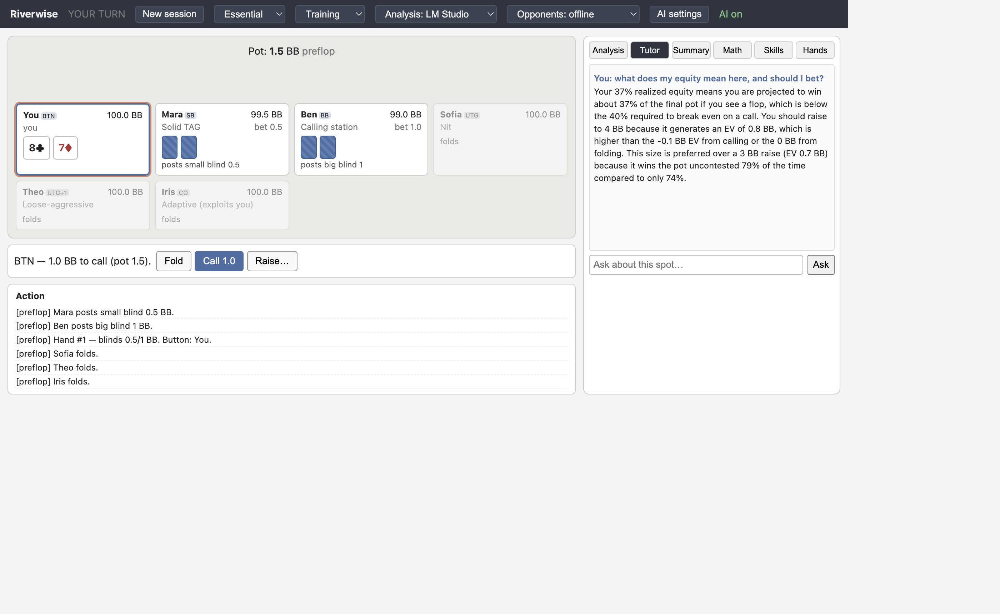

# Riverwise — AI Poker Coach

**▶ [Try it live in your browser](https://akashmlesde-cpu.github.io/riverwise/)**: no install, works offline.

Play No-Limit Hold'em against AI opponents, get every decision graded by an expected-value (EV) engine, and ask a tutor **"why?"** in plain English. The tutor's answers are grounded in the engine's numbers, so it can't invent equities or odds.



Runs entirely in the browser with no build step. Works fully offline; AI features are optional.

## What it does

- **Play** 2–9 seat cash games against 10 opponent styles (nit, calling station, loose-aggressive, adaptive, …).
- **Get graded** on every decision, Excellent to Blunder, judged only on what you knew at the time, never on the result.
- **Ask the tutor anything** about the live hand: *"how do I decide my raise size?"*, *"how did you calculate this EV?"*. It walks through the real formula with the real numbers.
- **Learn the math**: pot odds, required equity, realized equity, SPR, MDF, outs, and a guess-first mode that trains estimating at the table.
- **Track progress**: session skill stats, estimated cost of mistakes, and saved hand history.

## How it works

**1. Information isolation.** The rules engine holds the full game state, but the coach and every AI prompt receive only `coachView()`: your cards, the board, and public actions. Opponents' hole cards never reach the coach. Automated tests check that no payload contains hidden cards.

**2. EV engine.** Each opponent's range is tracked combo-by-combo and narrowed by their actions (raise, 3-bet, call, check) based on position and play style. For each option the engine estimates:
- *Equity* by Monte Carlo, dealing out the board thousands of times against hands sampled from those ranges
- *Realized equity*, adjusted for position and number of opponents
- *Bet and raise EV* by simulating whether each opponent folds or continues: `EV = P(all fold) × pot + P(called) × EV when called`

**3. AI that can't make up numbers.** The language model writes the explanations and tutor answers, but only from facts the engine computed. Every answer is checked before it is shown. It is rejected if it:
- quotes a number that isn't in the facts (one step of arithmetic on them is allowed)
- recommends a different action than the engine
- contradicts the grade
- claims a hand ranking it can't verify

A rejected answer gets one retry with the reason; after that, the engine's own explanation is shown.

**Opponents that play their style.** Each style (nit, TAG, loose-aggressive, calling station, …) has concrete preflop ranges. The built-in bots play by them, and the coach uses the same ranges to read opponents. Over 600 simulated hands each style lands near typical real-world stats (e.g. nit ≈10% of hands played, TAG ≈20%, LAG ≈30%), with real-world bet sizes. AI-driven opponents get the same numbers in their prompt, because a style label alone isn't enough: told only "you are a TAG", the model played 83% of hands.

**4. Bring your own AI, per role.** Analysis/tutor and opponents each use any OpenAI-compatible API (Groq, OpenAI, OpenRouter, a local LM Studio or Ollama server, or a custom endpoint) or run **offline** on the built-in engine. A local server answers one request at a time, so requests are queued by priority: tutor first, then opponents, then coach notes. Low-priority notes are interrupted rather than delaying the game. APIs that reject a parameter (such as `max_tokens`) are retried automatically with the format they expect.

## Run it

Open `index.html` in a modern browser, or serve the folder:

```sh
npm start          # python3 -m http.server 8080 → http://localhost:8080
```

No setup is needed for offline mode.

### Connect an AI (optional)

Click **AI settings**, pick a provider, enter the model (and API key for cloud providers), then **Save & test connection**. Then choose which AI to use for *Analysis* and *Opponents* in the header. Settings are stored only in your browser.

Any API that speaks the OpenAI chat-completions format works:

| Provider | Base URL | Key |
|---|---|---|
| Groq | `https://api.groq.com/openai/v1` | required |
| OpenAI | `https://api.openai.com/v1` | required |
| OpenRouter | `https://openrouter.ai/api/v1` | required |
| LM Studio | `http://localhost:1234/v1` | none |
| Ollama | `http://localhost:11434/v1` | none |
| Custom (llama.cpp, vLLM, Together, DeepSeek, Mistral, Gemini's OpenAI endpoint, …) | your base URL | if required |

Local servers must allow requests from the browser: in **LM Studio** turn on *Enable CORS* in the server settings; for **Ollama** start it with `OLLAMA_ORIGINS=*` if the connection test can't reach it.

To pre-set providers instead, copy `config.example.js` to `config.js` (git-ignored) and fill it in.

## Tests

```sh
npm test
```

123 checks across 7 suites in `tests/`, run headless in Node (no dependencies):

| Suite | Covers |
|---|---|
| `engine` | Full hands, chip conservation, side pots, bet/raise labelling |
| `isolation` | No coach or AI payload ever contains hidden hole cards |
| `grading` | Grades separate good from bad decisions; realistic fold equity |
| `cards` | Grade, EV ranking and explanation text always agree |
| `brief` | Regression hands: multiway equity, realization, street-specific coaching |
| `llm` | Provider switching, custom endpoints, tutor grounding, answer validation |
| `queue` | Local-model request priorities, interruption, stale-request drops |

## Project structure

```
index.html, styles.css   UI
js/engine.js             Rules engine: betting, side pots, showdown, player/coach views
js/ranges.js             Combo-accurate range tracking and sampling
js/coach.js              EV engine, grading, explanations, built-in tutor
js/spot.js               Spot classification and equity breakdowns
js/llm.js                AI providers, request queue, prompts, answer validation
js/opponents.js          10 opponent styles and the built-in opponent AI
js/app.js                UI controller
js/…                     Deck (Web Crypto shuffle), evaluator, poker math, stats, storage
tests/                   Headless test suites
```

## Limitations

Ranges and fold frequencies are modelled heuristics, not solver output, and EVs are Monte Carlo estimates with some noise. Close decisions are labelled as close rather than forced into a single "right" answer.

---

© 2026 Akash Kumar. All rights reserved.
